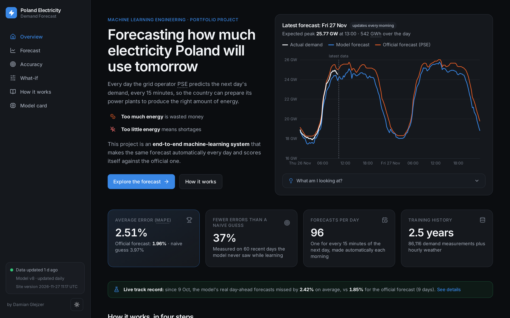
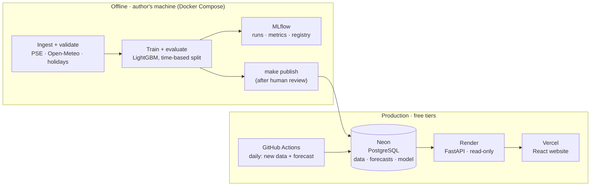
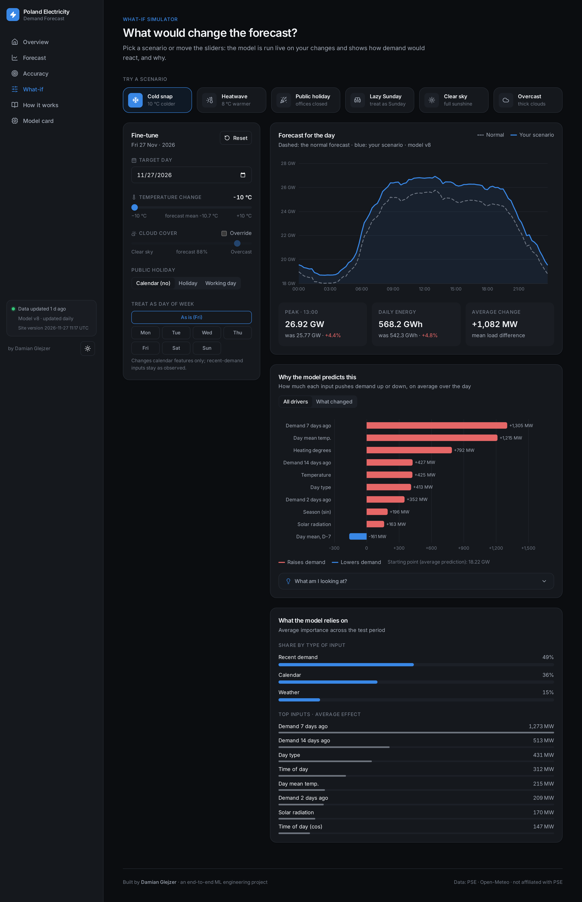

<div align="center">

# ⚡ Poland Electricity Demand Forecast

**Day-ahead forecasts of Poland's national electricity demand, every 15 minutes, produced by an end-to-end MLOps pipeline and scored every day against the grid operator's official forecast.**

[](https://github.com/YOUR-USERNAME/poland-electricity-forecast/actions/workflows/ci.yml)
[](https://github.com/YOUR-USERNAME/poland-electricity-forecast/actions/workflows/daily-forecast.yml)


[](LICENSE)

### [🔗 Live demo](https://poland-electricity-forecast.vercel.app) · [How it works](#how-it-works) · [Results](#results) · [Run locally](#run-it-locally) · [Deploy](docs/DEPLOY.md)

<sub>The demo runs on free hosting: the first load can take ~30 s while the API wakes up.</sub>

<br/>



</div>

---

## Why it matters

Electricity is hard to store, so power plants must produce exactly what the country uses, every moment. Every day, Poland's grid operator **PSE** predicts the next day's demand, so the country can prepare its power plants to produce the right amount of energy.

- **Too much energy** is wasted money: fuel is burned for power nobody uses.
- **Too little energy** means shortages: expensive emergency power or, at worst, blackouts.

This project makes the same day-ahead forecast automatically, publishes it on a website anyone can understand, and keeps an honest record of how it compares with the official one.

## At a glance

| | |
|---|---|
| **Forecast** | National demand for the next day, 96 values (one every 15 minutes) |
| **Data** | 86,000+ quarter-hours of demand since June 2024, weather for 8 Polish cities, the Polish holiday calendar. All public, no API keys |
| **Model** | LightGBM on 25 leakage-safe features, explained with SHAP |
| **MLOps** | MLflow tracking and registry, human-reviewed releases, a daily scheduled forecasting job, an append-only live track record |
| **Serving** | Read-only FastAPI with live what-if inference; React site written for non-specialists |
| **Quality** | 41 backend tests, browser end-to-end tests, CI on every push, a production rehearsal under free-tier limits |
| **Cost** | €0: Vercel, Render, Neon and GitHub Actions free tiers |

## Results

Hold-out test on the **last 60 complete days before training** (26 Sep – 24 Nov 2026), which the model never saw while learning. All three forecasts are scored on exactly the same 15-minute slots.

| Forecast | MAPE ↓ | MAE ↓ | RMSE ↓ |
|---|---:|---:|---:|
| **This model (LightGBM)** | **2.51 %** | **483 MW** | **626 MW** |
| PSE official day-ahead forecast | 1.96 % | 366 MW | 483 MW |
| Naive baseline: same time 7 days ago | 3.97 % | 766 MW | 1,087 MW |

- **37 % fewer errors than the naive baseline**, and within about half a percentage point of the forecast made by the national grid operator.
- **Accuracy is seasonal.** On an earlier hold-out (10 Aug – 8 Oct 2026) the same pipeline **beat PSE: 2.11 % vs 2.33 %**. Two years of history contain only one previous autumn, so rolling-origin backtesting across seasons is the next step (see [roadmap](#limitations-and-roadmap)).
- **A live track record** builds up every day. Forecasts are stored before each day starts and are never changed afterwards, so the site shows real day-ahead performance, not just a back-test.

> Results are reported as measured. Nothing is tuned on the test window, and the website only claims "beats the official forecast" when the numbers say so.

## How it works



1. **Collect.** PSE's API v2 provides actual demand *and* PSE's own forecast every 15 minutes. Weather (temperature, clouds, solar radiation, wind) comes from Open-Meteo for 8 metro areas, weighted by population. Every download is validated with **Pandera** before it is stored.
2. **Train (offline).** Features are built, LightGBM is trained with early stopping, the model is scored on the 60-day exam against PSE and the baseline, then refit on all data. Each run is logged and versioned in **MLflow**.
3. **Release.** After reviewing the run, `make publish` promotes the model, the data and the evaluation to the production database. Nothing goes live without a human decision.
4. **Forecast daily.** A **GitHub Actions** cron job downloads new data every morning and forecasts tomorrow with the published model. It never retrains.
5. **Serve.** A read-only **FastAPI** service on Render serves forecasts, metrics and explanations, and runs the model live for what-if scenarios. The **React** site on Vercel presents it all in plain language.

## The model

**25 features for every 15-minute slot:**

| Group | Features | Note |
|---|---|---|
| Calendar | time of day (with sin/cos), weekday, public holiday, bridge day, Christmas period, month, season | Polish holidays from `holidays`; bridge days derived |
| Recent demand | same slot 2, 7 and 14 days earlier; daily mean and peak 2 days earlier; daily mean a week earlier | **All ≥ 48 h old**, as if forecasting on the morning before, like PSE. A unit test proves there is no leakage |
| Weather | temperature, cloud cover, solar radiation, wind speed, daily mean temperature, heating and cooling degrees | Archived *forecasts*, so training inputs match prediction-time quality |

**Training and evaluation:**

```
14 Jun 2024 ──────────────────────────────────────────────────────── yesterday
[                 learn                  ][ tune: 30 days ][ exam: 60 days ]
                                            early stopping   never seen; scored vs
                                                             PSE and a naive baseline
→ then refit on everything and deploy
```

- LightGBM with an **L1 objective** (robust to spikes, aligned with MAPE).
- **PSE's forecast is never a feature**: it is only the benchmark.
- Explanations come from LightGBM's built-in **TreeSHAP**. The website shows which inputs push tomorrow's demand up or down.

## MLOps and engineering

| Practice | How it's done here |
|---|---|
| Experiment tracking and registry | Every run in **MLflow** (params, metrics, feature importance, model), registered as `pse-demand-lgbm` with a `production` alias |
| Human-in-the-loop releases | Training only offline; `make publish` promotes a reviewed model. The public site and the scheduler can't retrain |
| Stateless serving | The model is stored as text in Postgres (`model_artifacts`), so the API needs no disk and no MLflow server |
| Honest monitoring | Forecasts form an **append-only ex-ante record**; a live track record compares them with reality every day |
| Scheduled inference | GitHub Actions cron (twice daily, idempotent), connecting with a write-limited database user |
| Data quality | Pandera schemas at ingestion: ranges, a 15-minute grid, no duplicates; DST days (92/100 slots) handled and tested |
| Testing | 41 pytest tests (parsing with a real DST-day fixture, features, no-leakage, API, publish, security) and Playwright end-to-end tests of every page |
| CI | Lint, tests, frontend type-check and build, and a build plus smoke test of the production Docker image on every push |
| Reproducibility | Docker Compose for everything, `uv` lockfile, pinned npm versions, one-command setup |
| Production rehearsal | Prod image under Render's 512 MB limit (~140 MB used), read-only DB user, separate-origin frontend, the scheduler run from a clean environment |
| Security | Rate limits, caching, least-privilege DB users, CSP and security headers: see **[SECURITY.md](docs/SECURITY.md)** |

## The website

Six pages, written for people who aren't energy or ML specialists. Every chart has a "What am I looking at?" explanation, and terms like MAPE or GW show a definition on hover.

| Page | What it shows |
|---|---|
| **Overview** | The pitch, today's demand and tomorrow's forecast, headline numbers, how it works in four steps |
| **Forecast** | Any day since mid-2024: actual vs model vs official forecast, with peaks and per-day error |
| **Accuracy** | Errors explained in plain words, the live track record, error by day, by hour and by type of day |
| **What-if** | One-click scenarios (cold snap, heatwave, holiday, Sunday…) re-scored live, with SHAP drivers |
| **How it works** | Typical daily profile, demand vs temperature, the features, the train/test timeline, the MLOps lifecycle |
| **Model card** | Version, data windows, metrics, settings, intended use, limitations, version history |

<table>
  <tr>
    <td></td>
    <td></td>
  </tr>
  <tr>
    <td align="center"><sub><b>Accuracy</b>: error vs the official forecast and a naive baseline</sub></td>
    <td align="center"><sub><b>What-if</b>: a cold snap re-scored live, explained with SHAP</sub></td>
  </tr>
  <tr>
    <td></td>
    <td></td>
  </tr>
  <tr>
    <td align="center"><sub><b>How it works</b>: the data and the pipeline, with charts</sub></td>
    <td align="center"><sub><b>Light mode</b>: follows the system theme</sub></td>
  </tr>
</table>

## Tech stack

| Layer | Tools |
|---|---|
| Machine learning | LightGBM, SHAP (TreeSHAP), pandas, NumPy, Pandera |
| MLOps | MLflow, Docker, GitHub Actions, pytest, Playwright, Dependabot |
| Backend | Python 3.12, FastAPI, SQLAlchemy Core, PostgreSQL, uv, Ruff |
| Frontend | React 18, TypeScript, Vite, Tailwind CSS, ECharts, TanStack Query |
| Hosting | Vercel (website), Render (API), Neon (PostgreSQL), GitHub Actions (scheduler) |
| Data | [PSE API v2](https://api.raporty.pse.pl), [Open-Meteo](https://open-meteo.com), [python-holidays](https://pypi.org/project/holidays/) |

## Run it locally

Requirements: **Docker** (with Compose) and **make**. No API keys.

```bash
git clone https://github.com/YOUR-USERNAME/poland-electricity-forecast.git
cd poland-electricity-forecast
make up                      # Postgres, MLflow, API and website
make refresh && make train   # download ~2.5 years of data (~1 min), train and register (~1.5 min)
```

| | URL |
|---|---|
| Website | http://localhost:3000 |
| API docs (OpenAPI) | http://localhost:8000/api/docs |
| MLflow | http://localhost:5000 |

| Command | What it does |
|---|---|
| `make refresh` | Download the latest demand and weather data |
| `make train` | Train, evaluate and register a new model (MLflow), then forecast with it |
| `make forecast` | Forecast tomorrow with the current model, without retraining |
| `make publish` | Promote the current model and data to production (`PUBLISH_DATABASE_URL`) |
| `make test` / `make e2e` | Backend lint + tests / browser tests and screenshots |
| `make help` | All commands |

**Releasing a new model:** `make refresh && make train`, compare the run in MLflow, then `make publish`.

## Deploy your own

The whole stack runs on free tiers with no credit card. **[docs/DEPLOY.md](docs/DEPLOY.md)** walks through it step by step: Neon → first publish → least-privilege database users → Render (via [`render.yaml`](render.yaml)) → Vercel → the GitHub Actions secret → an uptime monitor.

## API

Read-only. Interactive docs at `/api/docs`.

| Method | Path | Returns |
|---|---|---|
| GET | `/api/series?start=YYYY-MM-DD&days=2` | 15-minute actual, official forecast, model forecast and baseline |
| GET | `/api/kpis` | Peak and energy of the forecast day, 30-day accuracy, data freshness |
| GET | `/api/benchmark?days=30` | Out-of-sample error: summary, daily, by hour, by day type |
| GET | `/api/track-record` | The same, for live day-ahead forecasts only |
| GET | `/api/insights` | Typical daily profile, daily demand vs temperature |
| GET | `/api/model`, `/api/model/importance` | Deployed model, version history, SHAP importance |
| POST | `/api/whatif` | Scenario `{temp_delta, cloud_cover, holiday, dow, date}` → curve + SHAP drivers (nothing stored) |
| GET | `/api/health`, `/api/status` | Health check, data and model status |

## Repository layout

```
backend/                  Python package (uv, Ruff, pytest) · multi-stage Dockerfile (dev / prod)
  src/pse_forecast/
    sources/              PSE v2 client, Open-Meteo client, Polish calendar
    validation.py         Pandera schemas
    pipeline.py           incremental data refresh
    features.py           leakage-safe, DST-aware feature engineering
    models/               LightGBM wrapper (+ TreeSHAP), naive baseline
    training.py           split → early stopping → evaluate → MLflow → refit → store
    model_store.py        model artifacts in the database
    forecast.py           forecasting with the deployed model (ex-ante record)
    publish.py            promote model + data to production
    security.py           rate limits, caching, request limits, security headers
    services.py, api/     read-only FastAPI service
  tests/                  41 tests incl. a real PSE DST-day fixture
frontend/                 React + TypeScript + Vite + Tailwind + ECharts · vercel.json
e2e/run.mjs               Playwright checks of every page + screenshots
infra/                    MLflow image, Postgres init, Neon least-privilege users (roles.sql)
.github/                  CI, the daily forecast job, Dependabot
render.yaml               Render blueprint for the API
docs/                     DECISIONS.md · DEPLOY.md · SECURITY.md · screenshots
```

## Design decisions

25 decisions, each with its reasoning and the alternatives considered, are in **[docs/DECISIONS.md](docs/DECISIONS.md)**. A few:

- **Only data since 14 June 2024**, when PSE switched from gross to net demand, so the target and the benchmark are on the same basis.
- **Demand features at least 48 h old:** a realistic morning-before forecast, fair against PSE.
- **Offline, human-reviewed training;** production only serves a published model.
- **The model lives in the database:** stateless serving that fits free, disk-less hosting.
- **Append-only forecasts:** a live track record nobody can quietly rewrite.

## Limitations and roadmap

- [ ] **Rolling-origin backtest** across all seasons instead of one 60-day window
- [ ] **Morning-of-D-1 actuals** as features (data that exists when PSE publishes), which should help close the gap with PSE
- [ ] Open-Meteo **"previous runs"** weather for a strictly D-1 vintage (the archive is slightly fresher than what was known, which makes test results a little optimistic)
- [ ] **Prediction intervals** with quantile LightGBM
- [ ] **Drift alerts** from the live track record, and monthly **champion/challenger** retraining proposed as a pull request

## Author

**Damian Glejzer**: ML / MLOps engineer. [LinkedIn](https://www.linkedin.com/in/YOUR-LINKEDIN) · [GitHub](https://github.com/YOUR-USERNAME)

---

<sub>Data: [PSE S.A.](https://api.raporty.pse.pl) public reports API · [Open-Meteo](https://open-meteo.com) (CC BY 4.0) · [python-holidays](https://pypi.org/project/holidays/). Not affiliated with PSE. Licensed under [MIT](LICENSE).</sub>
