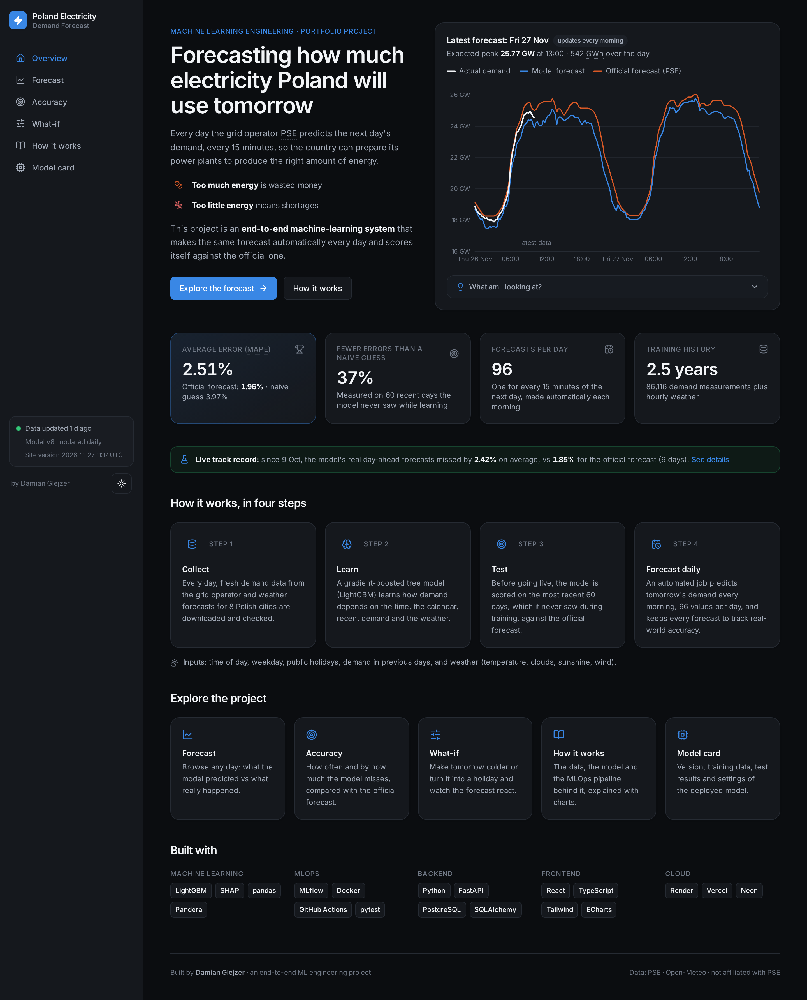
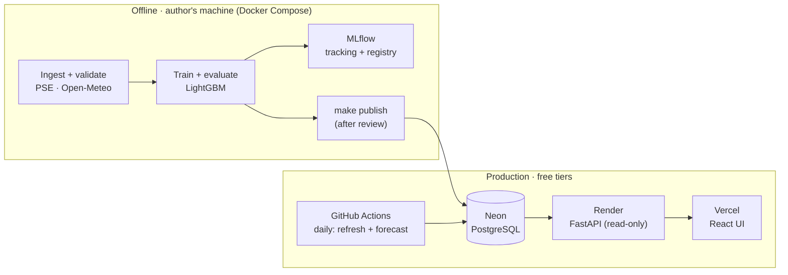
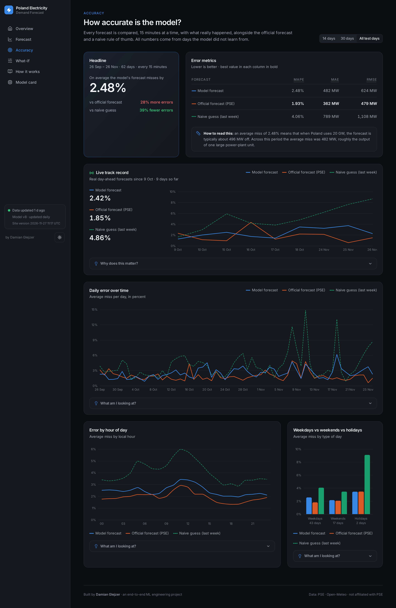
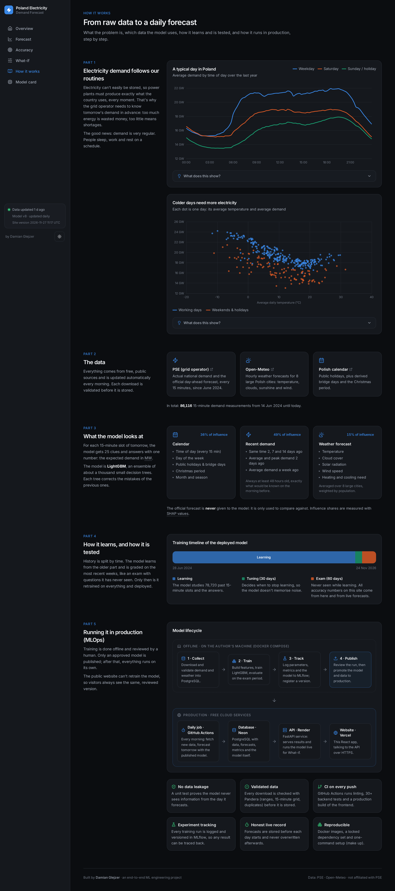
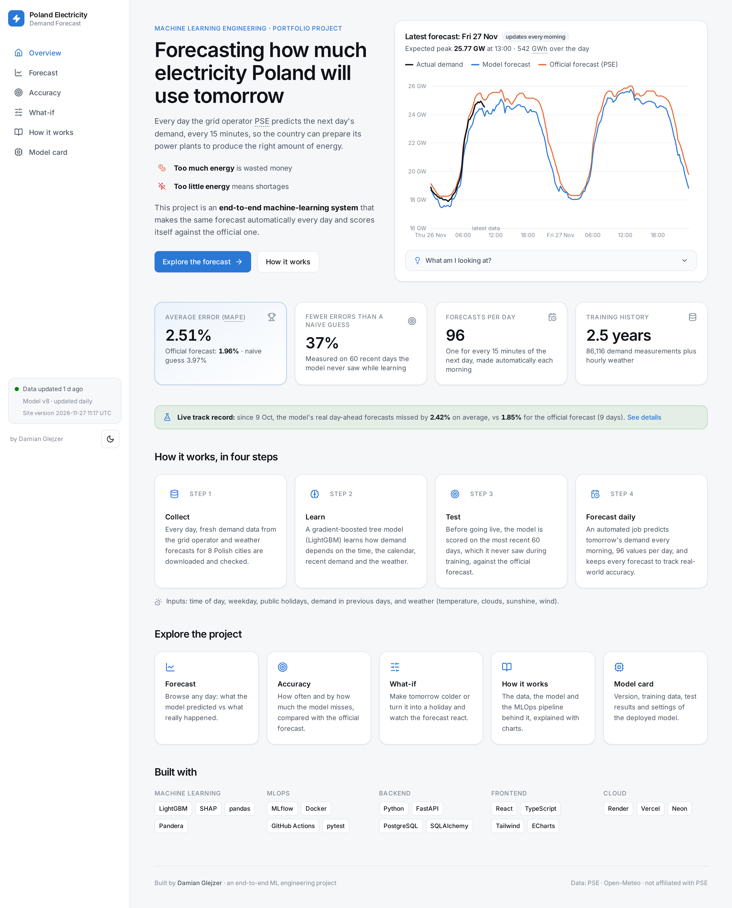

# Poland Electricity Demand Forecast

[](https://github.com/YOUR-USERNAME/poland-electricity-forecast/actions/workflows/ci.yml)
[](https://github.com/YOUR-USERNAME/poland-electricity-forecast/actions/workflows/daily-forecast.yml)

**Live demo: https://YOUR-APP.vercel.app** (the first load can take ~30 s while the free API server wakes up)

An end-to-end machine-learning system. Every day it forecasts **Poland's national electricity demand for the next day, every 15 minutes** (96 values per day), and scores itself against the **official forecast published by the grid operator PSE**.

It covers the whole lifecycle:

- **Data:** public data ingestion with validation.
- **Model:** leakage-safe feature engineering, then LightGBM training with a time-based hold-out.
- **MLOps:** experiment tracking and a model registry in MLflow, plus a publish step that promotes a reviewed model to production.
- **Serving:** a scheduled daily forecasting job, a read-only FastAPI service with live what-if inference and SHAP explanations.
- **UI:** a React site written for non-specialists.



## Results

Hold-out test: the **last 60 complete days before training** (26 Sep – 24 Nov 2026), never seen while learning. All three forecasts are scored on exactly the same 15-minute slots.

| Forecast | MAPE | MAE | RMSE |
|---|---:|---:|---:|
| **This model (LightGBM)** | **2.51 %** | **483 MW** | **626 MW** |
| PSE official day-ahead forecast | 1.96 % | 366 MW | 483 MW |
| Naive: same time 7 days ago | 3.97 % | 766 MW | 1,087 MW |

- **37 % fewer errors than the naive seasonal baseline**, and within about half a percentage point of the national grid operator's own forecast.
- On an earlier hold-out (10 Aug – 8 Oct 2026) the same pipeline scored **2.11 % vs PSE's 2.33 %**. Accuracy is clearly seasonal. The model has only seen one previous autumn, which is why the live track record and a rolling-origin backtest are next on the list.
- The site also keeps a **live track record**: forecasts are stored before each day starts and never overwritten, then compared with what actually happened.

## How it works



1. **Data.** PSE's API v2 entity `kse-load` provides actual demand *and* PSE's forecast every 15 minutes. History starts on **14 June 2024**, when PSE switched to net demand, so the target and the benchmark are on the same basis. Weather (temperature, clouds, radiation, wind) comes from Open-Meteo for 8 metro areas, weighted by population. Every download is validated with **Pandera**.
2. **Features (25).**
   - Time of day, weekday, Polish holidays and bridge days, season.
   - Demand 2, 7 and 14 days earlier.
   - Weather and heating/cooling degrees.

   Demand features are **at least 48 h old**, as if the forecast were made on the morning before, like PSE's. A unit test proves there is no leakage.
3. **Training (offline).** Time-based split: learn, then a 30-day validation window (early stopping), then the 60-day exam. Scored against PSE and the naive baseline, then refit on all data. Each run is logged to **MLflow**, registered as `pse-demand-lgbm` and aliased `production`.
4. **Publishing.** `make publish` promotes the reviewed model (stored as text in a `model_artifacts` table), the data and the evaluation to the public database. Production has no disk and no MLflow dependency.
5. **Daily forecasting.** A **GitHub Actions** cron job downloads new data and forecasts tomorrow with the *published* model. It never retrains. Forecasts for days that have started are never rewritten (an honest ex-ante record).
6. **Serving.** A read-only **FastAPI** service on Render serves forecasts, metrics and insights, and runs the model live for what-if scenarios, explained with LightGBM's built-in TreeSHAP. Visitors can't trigger training or data jobs.

## The website

| Page | What it shows |
|---|---|
| **Overview** | One-sentence pitch, headline numbers, today and tomorrow's forecast, how it works in 4 steps |
| **Forecast** | Any two days: actual vs model vs official forecast, peaks, per-day error |
| **Accuracy** | Error metrics explained in plain words, live track record, error by day, hour and day type |
| **What-if** | One-click scenarios (cold snap, holiday, Sunday…) and sliders, re-scored live with SHAP drivers |
| **How it works** | Typical daily profile, demand vs temperature, the data, the features, the train/test timeline, the MLOps lifecycle |
| **Model card** | Version, data windows, metrics, settings, intended use, limitations, version history |

<p>
  
  
</p>
<p>
  
  
</p>

## Run it locally

Requirements: **Docker** (with Compose) and **make**. No API keys.

```bash
git clone https://github.com/YOUR-USERNAME/poland-electricity-forecast.git && cd poland-electricity-forecast
make up                      # Postgres, MLflow, API and UI
make refresh && make train   # download ~2.5 years of data (~1 min), train and register (~1.5 min)
```

| | URL |
|---|---|
| Web UI | http://localhost:3000 |
| API docs (OpenAPI) | http://localhost:8000/api/docs |
| MLflow | http://localhost:5000 |

Other commands: `make forecast` (forecast only, no retraining), `make publish`, `make test`, `make fe-check`, `make e2e`, `make logs`, `make down`, `make clean`. Run `make help` for the full list.

### Retrain and release a new model

```bash
make refresh && make train   # new run in MLflow: compare it with the current one
make publish                 # happy with it? promote it to production (PUBLISH_DATABASE_URL in .env)
```

Deploying your own copy (Neon, Render, Vercel, GitHub Actions) is described step by step in **[docs/DEPLOY.md](docs/DEPLOY.md)**.

## API

| Method | Path | Purpose |
|---|---|---|
| GET | `/api/series?start=YYYY-MM-DD&days=2` | 15-min actual, PSE forecast, model forecast, baseline |
| GET | `/api/kpis` | Forecast-day peak and energy, 30-day accuracy, data freshness |
| GET | `/api/benchmark?days=30` | Out-of-sample error: summary, daily, by hour, by day type |
| GET | `/api/track-record` | The same, for live ex-ante forecasts only |
| GET | `/api/insights` | Typical daily profile, daily demand vs temperature |
| GET | `/api/model`, `/api/model/importance` | Deployed model, history, feature importance (SHAP) |
| POST | `/api/whatif` | `{temp_delta, cloud_cover, holiday, dow, date}` → scenario curve + SHAP |
| GET | `/api/status`, `/api/health` | Status and health check |

## Repository layout

```
backend/                  Python package (uv, Ruff, pytest), multi-stage Dockerfile (dev / prod)
  src/pse_forecast/
    sources/              PSE v2 client, Open-Meteo client, Polish calendar
    validation.py         Pandera schemas
    pipeline.py           incremental data refresh
    features.py           leakage-safe, DST-aware feature engineering
    models/               LightGBM wrapper (+ TreeSHAP), seasonal-naive baseline
    training.py           split → early stopping → evaluate → MLflow → refit → store
    model_store.py        model artifacts in the database
    forecast.py           forecasting with the deployed model (ex-ante record)
    publish.py            promote model + data to the public database
    security.py           rate limits, caching, request limits, security headers
    services.py, api/     read-only FastAPI service
  tests/                  parsing (real PSE fixture incl. DST), validation, features, API, publish/forecast
frontend/                 React + TypeScript + Vite + Tailwind + ECharts (vercel.json for deployment)
e2e/run.mjs               Playwright check of every page, interactions and screenshots
.github/                  CI, the daily forecast job, Dependabot
infra/neon/roles.sql      least-privilege database users for production
render.yaml               Render blueprint for the API
docs/                     DECISIONS.md, DEPLOY.md, SECURITY.md, screenshots
```

## Quality

- **41 backend tests:**
  - PSE parsing (a real 100-slot DST-day fixture), validation and calendar;
  - DST grids, lag correctness and an explicit **no-leakage** test;
  - the API end to end on synthetic data;
  - publishing and the ex-ante forecast rule;
  - security: read-only routes, rate limits, request limits, headers.
- **CI on every push:**
  - Ruff and pytest;
  - frontend type-check and build;
  - a build and smoke test of the production Docker image.
- **Browser test:** `make e2e` opens every page in dark, light and mobile views and applies a what-if preset. It checks that no refresh or retrain control exists and fails on any console or HTTP error.
- **Secure by design** ([docs/SECURITY.md](docs/SECURITY.md)):
  - a read-only public API with per-visitor and global rate limits, caching and request limits;
  - least-privilege database users (the API can only read, the daily job can only add data);
  - Content-Security-Policy and security headers;
  - least-privilege CI and Dependabot.
- **Reproducible:**
  - locked Python dependencies (`uv`, with a 2-week `exclude-newer` window);
  - exact npm versions;
  - tagged Docker images.

## Key decisions

Full reasoning in **[docs/DECISIONS.md](docs/DECISIONS.md)**. Highlights:

- **Training is offline and human-reviewed;** production only serves a published model and forecasts on a schedule.
- **The model lives in the database,** so the API is stateless and works on free, disk-less hosting.
- **Ex-ante forecasts are append-only,** which makes the live track record trustworthy.
- **Lags ≥ 48 h** give a realistic morning-before forecast, fair against PSE. PSE's forecast is never a feature.
- **Archived weather forecasts for training:** training inputs match inference-time quality (with a small optimism caveat).

## Limitations and next steps

- One 60-day hold-out window. **Rolling-origin backtesting** across seasons would give a fairer picture; results clearly vary by season.
- Add **D-1 morning actuals** (available when PSE publishes) and Open-Meteo "previous runs" weather for a strictly D-1 vintage.
- Probabilistic forecasts (quantile LightGBM) with prediction intervals.
- Drift and accuracy alerts on the live track record; automated retraining proposals as pull requests.

---

Data: [PSE S.A.](https://api.raporty.pse.pl) (public reports API), [Open-Meteo](https://open-meteo.com) (CC BY 4.0), [python-holidays](https://pypi.org/project/holidays/). Not affiliated with PSE. Licensed under MIT.
